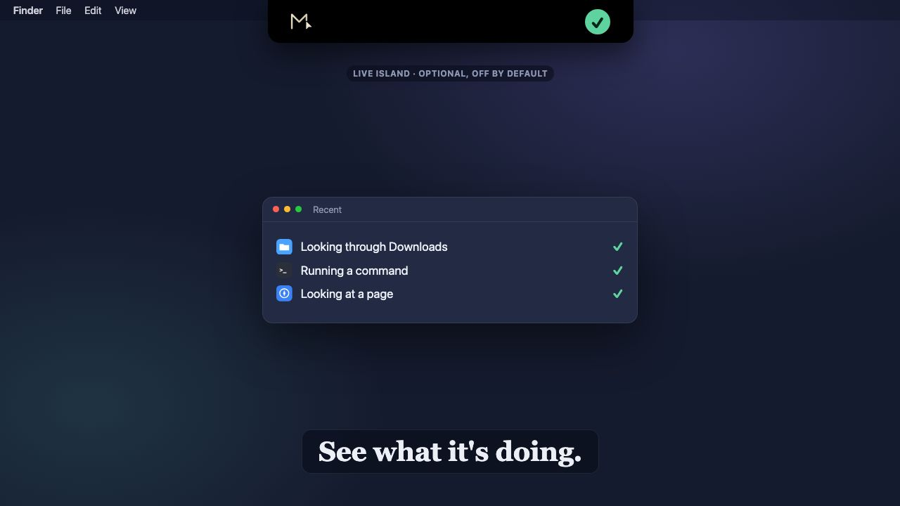

<p align="center">
  <a href="site/assets/media/mac-mcp-demo.mp4"></a>
</p>

# Mac MCP

**Let your AI apps use your Mac.** Mac MCP is a local server and menu bar app that lets Claude, ChatGPT, Codex, OpenCode and other MCP apps work in your Mac's apps, files, terminal and browser, with approvals you control. It is for people who already work with an AI app and want it to act on their Mac, not just talk about it.

- **It works inside your apps.** Your AI app opens Notes, looks through a folder in Finder or drafts a reply in Mail through macOS Accessibility, using the same buttons and menus you do. Files and the terminal are there too.
- **It browses where you can see it.** Visible, non-focus-stealing browser automation in Safari and Chrome: it works in a tab while you keep using your Mac, and frames the tab so you can see what it touches.
- **It hands off work and reports back.** Delegate a task to Codex, Claude Code, OpenCode or one of seven other agent CLIs and read a report of what it did.
- **It answers from your documents.** Pick folders in Settings › Privacy and your AI app can ask what your contracts, invoices or notes say, and get the file and page back. The index stays on your Mac.
- **It automates the repeat work.** Scheduled Tasks run AI tasks and scripts on their own; Recipes save a job your AI did once and replay it with one click, from Settings, the Shortcuts app or Siri.

[Watch the 40-second demo](site/assets/media/mac-mcp-demo.mp4) · Website: [bulutarkan.github.io/mac-mcp](https://bulutarkan.github.io/mac-mcp/) · [Install](docs/install.md#install) · MIT

**Quick install:** download the `.pkg` from the [latest release](https://github.com/bulutarkan/mac-mcp/releases/latest) (Apple Silicon, macOS 14 or later), or run the installer on any Mac with macOS 13 or later:

```bash
curl -fsSL https://raw.githubusercontent.com/bulutarkan/mac-mcp/main/install.sh | bash
```

or with Node.js: `npx @bulutarkan/mac-mcp install` (the same installer, [details](docs/install.md#npm-macos-13-apple-silicon-or-intel)).

**You stay in charge.** Permission profiles decide what may run and optional Server Approval asks before risky actions; you can pause observation, turn on private mode, or keep apps and sites out of reach. Mac MCP is not a sandbox: it acts with your macOS user's permissions, localhost is machine-local transport, not same-user isolation, and what your AI app reads is sent to that app's provider. See [Product and security terminology](docs/safety.md#product-and-security-terminology).

## What's new in 2.3.1

2.3.1 brings Mac MCP Chat, a calmer native app and steadier agent teams.

**Mac MCP Chat**
- **Your own agents in a project folder:** Claude, Codex, OpenCode, GitHub Copilot, Antigravity, Kilo Code, Kimi Code, Goose and Cline, each signed in as you through its own CLI, with Mac MCP added for the Mac. Models, thinking and modes come from the agent itself.
- **Work alongside it:** answers stream in, each step opens to show what it did, file edits show their diff and commands their output as a live terminal. Add files and images, write while the agent works (the message waits its turn), and get a notification when a chat in the background finishes.

**A calmer app**
- **Settings in one look:** every pane speaks the same quiet language, with logos and status dots instead of long cards; Usage has tabs for Tools, Delegated Agents, Chat and Data & Storage.
- **The menu** shows one card at a time, the most important first, and says just "Ready" when idle.

**Agents**
- **Teams** check every setting before they start, can read the full report of a task they depend on, and never lose a message to an agent that already finished.
- **Delegated agents** look up your memories and skills before they search, and **GitHub Copilot** joins as an agent provider.

Earlier releases are in the [CHANGELOG](CHANGELOG.md).

## Choose your path

- **[Connect your AI apps](docs/connect.md):** Claude Desktop, Claude Code, ChatGPT, Codex, OpenCode and other MCP apps, plus a public address for ChatGPT.
- **[Install, update and permissions](docs/install.md):** requirements, the package and the installer, a manual install, updates and macOS permissions.
- **[Browser work](docs/browser.md):** Safari and Chrome tabs without taking over your Mac, saved logins, privacy controls and the Visual Companion.
- **[Safety, permissions and undo](docs/safety.md):** what the security words mean, permission profiles, Server Approval and file undo.
- **[The menu bar app](docs/menu-app.md):** installing it and what the menu shows.
- **[Agents and Scheduled Tasks](docs/agents-and-tasks.md):** delegating to Codex, Claude Code, OpenCode and seven other agents, giving an agent a desktop of its own, and running tasks on a schedule; recipes are in the [developer reference](docs/reference.md).
- **[Developer reference](docs/reference.md):** the MCP and REST surfaces, server commands, voice, the dashboard and tool coverage.
- Configuration, security details and terminology: [CONFIGURATION](docs/CONFIGURATION.md), [Local API security](docs/LOCAL_API_SECURITY.md), [Security assurance](docs/security-assurance.md), [TERMINOLOGY](docs/TERMINOLOGY.md).

## Agent Skills sync

Mac MCP's `skill_list`, `skill_search`, and `skill_get` automatically discover user-level Agent Skills installed for CLI agents (including Claude Code, Codex, OpenCode, Gemini, Kimi, Pi, Kilo, Cline, and Goose) as well as the skills in `~/.mac-mcp/skills`. The shared `~/.agents/skills` folder is preferred over agent-specific duplicates, explicitly registered paths come next, and Mac MCP's own managed skills take final precedence on a name collision. No source files are copied or changed.

The catalog refreshes when a skill tool is called: installing, editing, or removing a CLI skill is reflected on the next request without manually importing it or restarting the server. It indexes `SKILL.md` only from direct child folders of supported user-level directories; project-local skills are not imported. Set `MAC_MCP_CLI_SKILLS_DIRS` to a colon-separated list of global skills directories to override discovery, or to an empty string to disable it. When `MAC_MCP_SKILLS_DIR` is set for an isolated/custom instance, CLI discovery is off unless explicitly configured.

## Install

**Package (Apple Silicon, macOS 14+):** download `Mac-MCP-…-arm64.pkg` from the [latest GitHub Release](https://github.com/bulutarkan/mac-mcp/releases/latest) and open it. It installs the menu bar app and the server for your account and starts them; nothing else is needed. It is not notarized yet, so the first open needs System Settings → Privacy & Security → **Open Anyway**.

**Installer (macOS 13+, Apple Silicon or Intel):**

```bash
curl -fsSL https://raw.githubusercontent.com/bulutarkan/mac-mcp/main/install.sh | bash
```

Then connect your AI app ([Connect your AI apps](docs/connect.md)). A manual install, updates and permissions are in [Install, update and permissions](docs/install.md).

## Contributing and security

Contributions are welcome. See [CONTRIBUTING.md](CONTRIBUTING.md) for the development and pull request workflow. Use the GitHub issue forms for bugs and feature requests, follow [SECURITY.md](SECURITY.md) for private vulnerability reporting, and see [CODE_OF_CONDUCT.md](CODE_OF_CONDUCT.md) for community expectations.

## Development

Run tests:

```bash
python -m unittest discover -s tests -v
```

Build the native menu app without installing it:

```bash
./menu_app/build_app.sh /tmp/mac-mcp-build
```

Project layout:

```text
mcp_server/   Python MCP server and dashboard
menu_app/     Native SwiftUI menu bar controller
tests/        Regression tests
openapi/      REST/OpenAPI schema assets
```

## License

MIT
